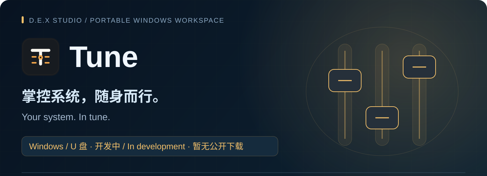
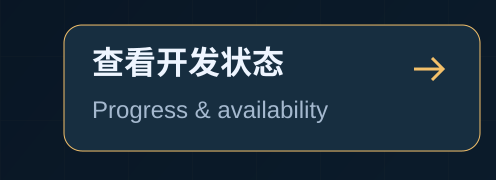
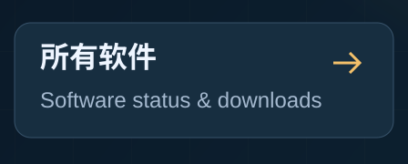
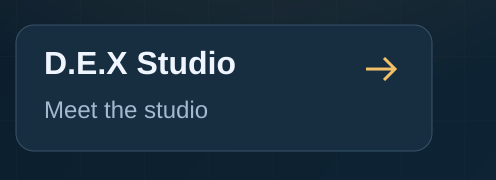
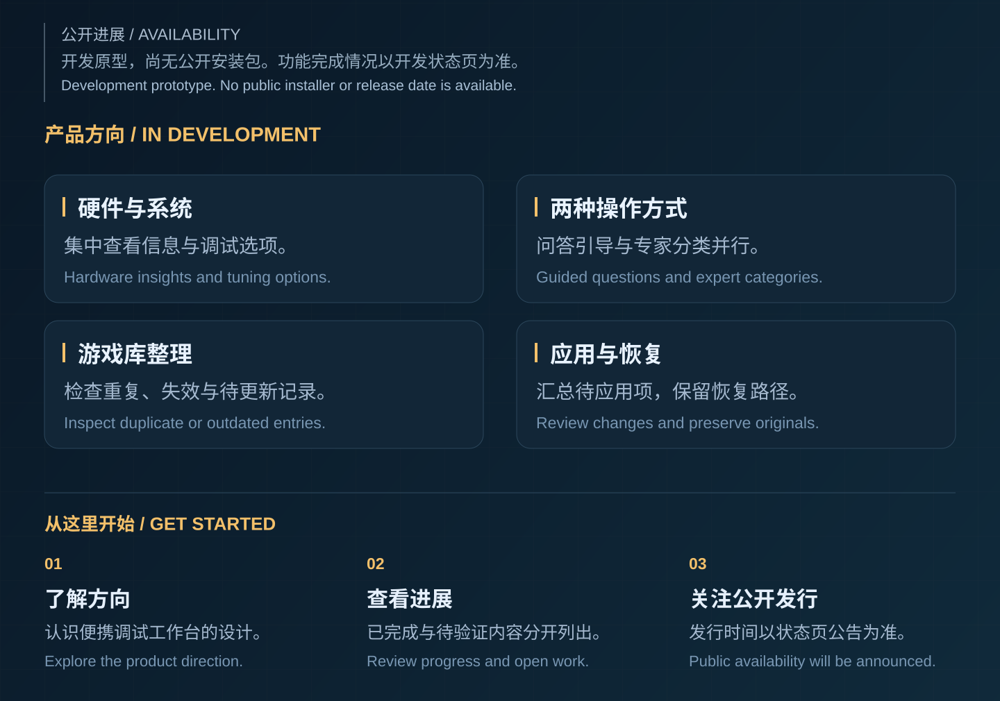

展开使用说明与链接 / Read details & links

文字版介绍与常用链接 / Accessible overview & links

Windows / U 盘 · 开发中 / In development · 暂无公开下载

- **硬件与系统**：集中查看信息与调试选项。 Hardware insights and tuning options.
- **两种操作方式**：问答引导与专家分类并行。 Guided questions and expert categories.
- **游戏库整理**：检查重复、失效与待更新记录。 Inspect duplicate or outdated entries.
- **应用与恢复**：汇总待应用项，保留恢复路径。 Review changes and preserve originals.

- [查看开发状态 / Progress & availability](https://github.com/dex-ovo-studio/DEX-TUNE/blob/main/STATUS.md)
- [所有软件 / Software status & downloads](https://github.com/dex-ovo-studio/DEX-Studio-Software-Status)
- [D.E.X Studio / Meet the studio](https://github.com/dex-ovo-studio)

公开发行时间尚未确定；功能完成情况请以[开发状态](https://github.com/dex-ovo-studio/DEX-TUNE/blob/main/STATUS.md)为准。  
No public release date is set. See the development status for completed and pending work.

