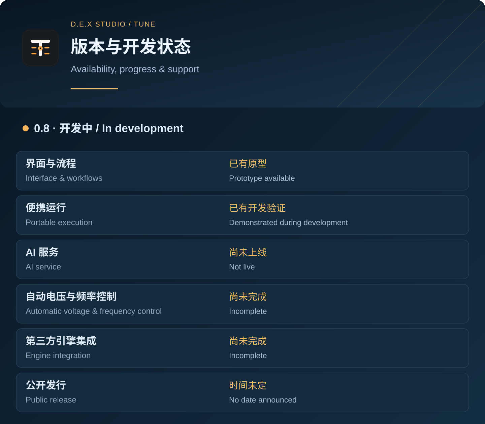

文字版状态 / Accessible status

[← Tune](https://github.com/dex-ovo-studio/DEX-TUNE) · [所有软件 / All software](https://github.com/dex-ovo-studio/DEX-Studio-Software-Status)

**🟠 开发中 · 暂无公开安装包 / In development · No public installer**  
0.8 · 开发原型 / Development prototype

| 内容 / Area | 状态 / Status |
| :--- | :--- |
| 界面与流程 / Interface & workflows | 已有原型 / Prototype available |
| 便携运行 / Portable execution | 已有开发验证 / Demonstrated during development |
| AI 服务 / AI service | 尚未上线 / Not live |
| 自动电压与频率控制 / Automatic voltage & frequency control | 尚未完成 / Incomplete |
| 第三方引擎集成 / Engine integration | 尚未完成 / Incomplete |
| 公开发行 / Public release | 时间未定 / No date announced |

公开发行时间尚未确定。上表仅表示已记录的开发进展，不代表完整功能已可公开使用。  
No public release date is set. Recorded progress does not mean the full product is ready for public use.

进度记录 / Progress as of 2026-11-11

